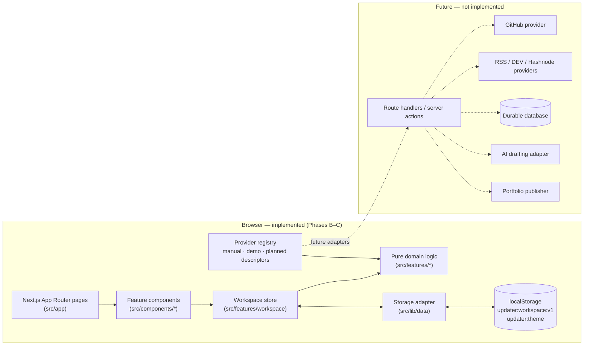
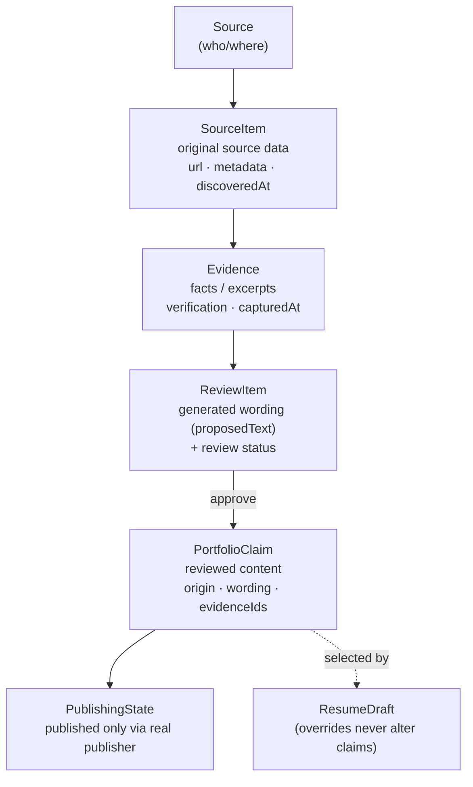
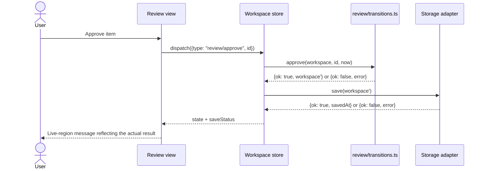

# Updater — Technical Architecture

| Field | Value |
| --- | --- |
| Version | 0.1.0 |
| Last updated | 2026-10-29 |
| Phase | Phase C — Core functionality complete (awaiting owner review). The local MVP described below is implemented; items tagged [Future] are not. |
| Related | [`PRD.md`](./PRD.md) · [`design.md`](./design.md) · [`memory.md`](./memory.md) · [`rules.md`](./rules.md) · [`tracker.md`](./tracker.md) |

> **Implementation status convention.** Each component, module, and interface below is tagged:
> **[Implemented]** exists in the repository and is verified;
> **[MVP]** is planned for the MVP (Phases B–D) and not yet built;
> **[Future]** is planned after the MVP (tracker Phase 10).
> At the end of Phase C, everything tagged [MVP] in §1–§13 is **[Implemented]** except the committed Playwright suite (T9.9, Phase D). Where the implementation differs from the original plan, §5.13 lists the differences.

## 1. Architecture overview

Updater's MVP is a **single Next.js application that runs entirely in the user's browser** for data handling. Pages are rendered by Next.js. All workspace data (profile, sources, evidence, review items, portfolio, resumes) lives in a versioned document in browser storage. There is no backend database, no authentication, no external API call, and no AI provider in the MVP. This is deliberate (see D-003 and D-004 in §17). It keeps the app usable without credentials and makes every displayed integration state truthful.

Principal components:

| Component | Responsibility | Status |
| --- | --- | --- |
| App shell and routes (`src/app`, `src/components/layout`) | Layout, navigation, page composition, error boundaries | [Implemented] |
| UI components (`src/components`) | Accessible presentational building blocks and feature views | [Implemented] |
| Theme (`src/lib/theme`, `src/components/theme`) | Theme rules, bootstrap script, browser store, toggle and Appearance control | [Implemented] |
| Workspace store (`src/features/workspace`) | Client state container, action dispatch, save status | [Implemented] |
| Domain logic (`src/features/*`, pure modules) | Review transitions, claim provenance, proposal generation, completeness, tailoring | [Implemented] |
| Validation (`src/lib/validation`) | Runtime schemas for persisted, imported, and user-entered data | [Implemented] |
| Storage adapter (`src/lib/data`) | Load, validate, migrate, and save the workspace document | [Implemented] |
| Provider registry (`src/lib/providers`) | Source provider definitions: Manual entries, Demo workspace, plus Planned descriptors | [Implemented] (descriptors only; no provider performs network I/O) |
| Route handlers / server APIs | Server-side ingestion, OAuth callbacks, persistence | [Future] |
| GitHub and blog providers | Real ingestion | [Future] |
| Durable database, accounts | Multi-device persistence | [Future] |
| AI drafting provider | Optional evidence-grounded wording drafts | [Future] |
| Portfolio publisher | Real public deployment | [Future] |



**Rationale.** The core value of the product is the workflow: evidence → proposal → review → approved content → portfolio and resume. That workflow can be built, tested, and used locally first. External integrations then plug into a stable provider contract (§9) without rewriting the review queue or editors.

## 2. Technology stack

Exact versions are pinned in `package.json` and `package-lock.json`. Those files are authoritative, and this document does not repeat version numbers.

| Concern | Choice | Status | Notes |
| --- | --- | --- | --- |
| Framework | Next.js, App Router, Turbopack (dev and build) | [Implemented] | Scaffolded with `create-next-app`. Cache Components enabled (scaffold default, D-011). |
| UI runtime | React 19 | [Implemented] | |
| Language | TypeScript, `strict: true` | [Implemented] | `npm run typecheck` runs `next typegen && tsc --noEmit`. |
| Styling | Tailwind CSS v4 via `@tailwindcss/turbopack`, with semantic CSS custom properties | [Implemented] | Full token set in `globals.css`. Default palette, font sizes, and weights are reset so only tokens are usable (D-014). |
| Fonts | System font stacks; no web-font download | [Implemented] | D-002 |
| Linting | ESLint 9 with `eslint-config-next` (core-web-vitals and TypeScript) | [Implemented] | |
| Icons | `lucide-react` | [Implemented] | |
| Accessible primitives | Radix UI primitives (`radix-ui`), styled with Tailwind | [Implemented] | D-005. Dialog, AlertDialog, DropdownMenu, Tabs, Tooltip, Switch, Checkbox, RadioGroup, Toast, Slot. |
| Validation | Zod schemas, with types inferred from them | [Implemented] (helpers) | D-006. Entity schemas arrive with T3.1. |
| Forms | Controlled React components plus shared Zod validation helpers | [Implemented] | D-006, D-026. Explicit Save per section with an "Unsaved changes" marker. No `react-hook-form`. |
| Unit and component tests | Vitest, Testing Library, jsdom | [Implemented] | D-007, D-015. `npm test`. Config in `vitest.config.mts`, browser API stubs for Radix in `vitest.setup.ts`. |
| End-to-end tests | Playwright | [MVP] | D-007. Journeys A–E were run with a one-off script in Phase C; the committed `e2e/` suite is T9.9. |
| Persistence | `window.localStorage`, through a storage adapter | [Implemented] | D-003, D-019–D-021 |

## 3. Application layers

| Layer | Location | Responsibilities | Must not |
| --- | --- | --- | --- |
| Routing and page composition | `src/app/**` | Route segments, layouts, metadata, `error.tsx`/`not-found.tsx`. Pages compose feature components. | Contain business rules |
| UI components | `src/components/ui` | Generic, accessible, presentational primitives (Button, Field, Dialog, StatusBadge…) | Import workspace state or domain modules |
| Theme | `src/lib/theme` (rules, bootstrap script, DOM store), `src/components/theme` (hooks, toggle, Appearance) | Theme state lives on `<html data-theme>` and is read with `useSyncExternalStore` | Use React context for theme state, or read the OS preference |
| Feature components | `src/components/{layout,dashboard,sources,review,portfolio,resumes,settings}` | Feature-specific views. Read state through workspace hooks and dispatch actions. | Mutate state directly or bypass domain transitions |
| Feature modules (domain logic) | `src/features/<feature>/*.ts` | Pure functions: state transitions, proposal generation, completeness, tailoring. Unit-tested. | Import React, Next.js, or browser APIs |
| Workspace state | `src/features/workspace` | React context and reducer composed from domain functions, persistence scheduling, save status | Contain feature rules beyond orchestration |
| Domain types | `src/types` | TypeScript types (inferred from schemas) shared across layers | Contain logic |
| Validation | `src/lib/validation` | Zod schemas for persisted data, imports, and form input. URL and text helpers. The `Result`/`AppError` types (`result.ts`), `validate()` and `toFieldErrors()` (`field-errors.ts`), `safeExternalUrl()` (`url.ts`). | Depend on UI |
| Persistence | `src/lib/data` | `WorkspaceStorage` adapter: load, validate, migrate, save. Demo fixtures. | Store secrets |
| Source-provider adapters | `src/lib/providers` | Provider definitions, capability metadata, and (for real providers) fetch and normalize | Write to storage directly. Providers return data, and the store records it. |
| Authentication and authorization | none yet | [Future] server-side session and ownership checks (§10) | |
| AI-provider adapters | none yet | [Future] optional `DraftingProvider` (§12) | |
| Publishing adapters | none yet | [Future] `Publisher` (§13) | |
| Utilities | `src/lib/utils` | IDs, dates, class names (`cn`), small helpers | Accumulate unrelated logic |
| Navigation config | `src/lib/navigation.ts` | Labels, routes, and page descriptions for the six destinations; active-route matching | Import React |

Business logic stays independent of presentation. Every rule in §7 lives in a pure module and can be tested without rendering.

## 4. Application structure

Target structure for the MVP. Folders are created only when they get real content.

```
.
├── AGENTS.md  PRD.md  architecture.md  design.md  memory.md  rules.md  tracker.md  README.md
├── .env.example  .gitignore  package.json  tsconfig.json  next.config.ts  eslint.config.mjs
├── public/
└── src/
    ├── app/
    │   ├── layout.tsx            # root layout, theme bootstrap script, app shell
    │   ├── page.tsx              # Overview
    │   ├── onboarding/page.tsx
    │   ├── sources/page.tsx
    │   ├── review/page.tsx
    │   ├── portfolio/page.tsx
    │   ├── resumes/page.tsx
    │   ├── resumes/[resumeId]/page.tsx
    │   ├── settings/page.tsx
    │   ├── error.tsx  not-found.tsx
    │   └── globals.css           # design tokens + Tailwind theme mapping + print styles
    ├── components/
    │   ├── layout/   ui/   dashboard/   sources/   review/   portfolio/   resumes/   settings/
    ├── features/
    │   ├── workspace/            # store, context, actions, persistence wiring
    │   ├── review/               # transitions.ts, proposals.ts (+ tests)
    │   ├── portfolio/            # claims.ts, projects.ts, completeness.ts (+ tests)
    │   ├── resumes/              # drafts.ts, tailoring.ts (+ tests)
    │   └── sources/              # ingestion.ts (validate → normalize → evidence) (+ tests)
    ├── lib/
    │   ├── data/                 # storage.ts, migrations.ts, demo-fixtures.ts
    │   ├── providers/            # types.ts, registry.ts, manual.ts, demo.ts, planned.ts
    │   ├── validation/           # schemas.ts, url.ts
    │   └── utils/
    └── types/
        └── domain.ts
```

Tests live next to the module they test (`*.test.ts`, `*.test.tsx`). End-to-end tests live in `e2e/`.

**Implemented at the end of Phase C** (no `src/lib/utils` beyond `cn`, `ids`, `dates`; no `e2e/` yet):

```
src/
├── app/            layout.tsx · page.tsx (Overview) · onboarding/ · sources/ · review/ · portfolio/
│                   resumes/ · resumes/[resumeId]/ · settings/ · error.tsx · not-found.tsx · globals.css
├── components/
│   ├── providers.tsx          # TooltipProvider, ToastProvider, ThemeSync, WorkspaceProvider
│   ├── layout/                # shell, sidebar, top bar (+ demo indicator), drawer, nav (+ pending count)
│   ├── theme/  ui/            # unchanged from Phase B (TabsList is now the containing block for sr-only text)
│   ├── workspace/             # workspace-provider (context + hooks), workspace-gate (loading/recovery),
│   │                          # save-status, badges, external-link, download
│   ├── hooks/                 # use-media-query, use-unsaved-warning
│   ├── dashboard/ sources/ review/ portfolio/ resumes/ settings/ onboarding/
├── features/
│   ├── workspace/             # workspace.ts (factory, selectors, activity), store.ts, integrity.ts, transfer.ts
│   ├── profile/profile.ts     # updateProfile, updateProfileLinks, profileChecklist
│   ├── sources/               # ingestion.ts, manual.ts, demo.ts
│   ├── review/                # proposals.ts, transitions.ts
│   ├── portfolio/portfolio.ts # projects, claims, skills
│   ├── resumes/               # drafts.ts (incl. buildResumeDocument), tailoring.ts
│   ├── overview/summary.ts    # next action, recent items, counts
│   └── onboarding/onboarding.ts
├── lib/
│   ├── data/                  # storage.ts, migrations.ts, demo-fixtures.ts
│   ├── providers/             # types.ts, registry.ts (manual, demo, planned github and rss)
│   ├── validation/            # result.ts, url.ts, schemas.ts, field-errors.ts, domain.ts (entity schemas)
│   └── utils/                 # cn.ts, ids.ts, dates.ts
├── test/                      # fixtures.ts, render.tsx (test helpers)
└── types/domain.ts            # types inferred from the schemas
```

### 4.1 Cache Components and preserved routes [Implemented]

With `cacheComponents` enabled (D-011), Next.js keeps up to three visited routes mounted but hidden (React `<Activity>`, `display: none`) instead of unmounting them. Consequences for this codebase:

- **Route focus** lives in `PageHeader`. It focuses the `h1` in an effect when the page becomes visible, which covers both new and restored pages. A module-level "last focused path" prevents moving focus on the initial load and on Strict Mode's effect re-run.
- **Transient UI** (open menus, dialogs inside pages) must reset when hidden: close it in a `useLayoutEffect` cleanup or with `Link`'s `onNavigate` (the mobile drawer uses `onNavigate`).
- **Tests and DOM queries** must prefer accessibility-tree queries (`getByRole`), which ignore hidden routes.
- **`usePathname`** may suspend on routes with dynamic params not covered by `generateStaticParams` (for example `/resumes/[resumeId]`). The navigation components wrap it in `<Suspense>` with a usable fallback, so the shell stays prerenderable.

### 4.2 Theme flow [Implemented]

1. The root layout renders `<html data-theme="light" suppressHydrationWarning>` and an inline script in `<head>` (`THEME_BOOTSTRAP_SCRIPT`). Before first paint, the script copies a valid stored value from `localStorage["updater:theme"]` to `data-theme`.
2. Tokens in `globals.css` are defined for `:root, [data-theme="light"]` and `[data-theme="dark"]`.
3. React reads the theme with `useSyncExternalStore`: the server snapshot is `light`, and the client snapshot is the attribute, observed with a `MutationObserver`. No hydration mismatch occurs.
4. `setTheme()` applies the attribute and returns a `Result` from the storage write. The UI warns when the choice cannot persist.
5. `ThemeSync` re-applies the stored value after hydration (React's development remount resets `<html>` attributes) and listens for `storage` events from other tabs.

## 5. Domain model

All identifiers are opaque strings generated with `crypto.randomUUID()`, with a readable prefix such as `src_`, `item_`, `ev_`, `claim_`, `proj_`, `rev_`, or `res_`. All timestamps are ISO 8601 UTC strings. Every entity carries `createdAt` and `updatedAt` unless noted. Every entity derived from demo fixtures carries `isDemo: true`.

### 5.1 `UserProfile`

- **Purpose:** the developer's identity as shown in the portfolio and resumes.
- **Fields:** `id`, `name` (required, 1–100 chars), `headline` (≤140), `intro` (≤2000), `location?` (≤100), `email?` (validated email; optional, shown only if the user enters it), `links: ExternalLink[]` (`{ id, label, url }`; `url` must be http/https), `createdAt`, `updatedAt`.
- **Relationships:** one per workspace.
- **Validation:** trimmed strings. Empty optional strings are normalized to `undefined`.

### 5.2 `Source`

- **Purpose:** a configured origin of evidence (Manual entries, Demo workspace, and in future a GitHub account or blog feed).
- **Fields:** `id`, `providerId` (`manual` | `demo` | `github` | `rss` | …), `displayName`, `accountLabel?` (for example a GitHub username; never a token), `status` (§7.3), `lastSync?: { attemptedAt, outcome: 'succeeded'|'failed'|'rate_limited', message?, itemCount? }`, `isDemo`, `createdAt`, `updatedAt`.
- **Relationships:** has many `SourceItem`.
- **Validation:** `providerId` must exist in the provider registry. The status must be one the provider can actually produce (a Planned provider cannot be `connected`).

### 5.3 `SourceItem`

- **Purpose:** the normalized snapshot of one original thing: a repository, pull request, article, contribution, or user-entered project or achievement. It is the **original source data** layer.
- **Fields:** `id`, `sourceId`, `externalId` (provider's ID; for manual items, the item ID), `kind` (`repository` | `pull_request` | `article` | `contribution` | `project` | `achievement`), `title`, `url?`, `occurredAt?` (published, merged, or completed date as reported), `discoveredAt` (when Updater imported or created it), `metadata: Record<string, string | number | boolean | string[]>` (normalized provider fields such as language, topics, repository, or state), `body?` (plain text, ≤5000 chars), `isDemo`, `createdAt`, `updatedAt`.
- **Relationships:** belongs to a `Source` and has many `Evidence`.
- **Validation:** `(sourceId, externalId)` is unique. The URL passes `safeExternalUrl`. All text is stored as plain text.

### 5.4 `Evidence`

- **Purpose:** a specific fact or excerpt drawn from a source item or stated by the user. It is the **extracted evidence** layer.
- **Fields:** `id`, `sourceItemId`, `kind` (`fact` | `excerpt` | `user_statement`), `statement` (plain text), `facts?: { key, value }[]` (structured facts, such as `language: TypeScript`), `verification` (`source_reported` = taken verbatim or structurally from provider data; `user_asserted` = stated by the user, not externally verified; `conflicting` = contradicts other evidence; `unverified` = imported but not yet checked), `conflictsWith?: string[]` (evidence IDs), `capturedAt`, `isDemo`.
- **Relationships:** belongs to one `SourceItem` and supports many `PortfolioClaim`s.
- **Validation:** `sourceItemId` must reference an existing item. Evidence never references a claim.

### 5.5 `PortfolioProject`

- **Purpose:** a project shown in the portfolio and selectable in resumes.
- **Fields:** `id`, `name`, `summary` (claim-like wording, with `summaryClaimId?` linking provenance), `technologies: string[]`, `links: ExternalLink[]`, `claimIds: string[]` (ordered achievements), `sourceItemIds: string[]`, `visible: boolean` (shown in the portfolio), `order: number`, `isDemo`, `createdAt`, `updatedAt`.
- **Relationships:** has many claims and references source items.

### 5.6 `PortfolioClaim`

- **Purpose:** a sentence asserting something about the developer's work. It is the **reviewed content** layer once approved.
- **Fields:** `id`, `text` (≤500), `origin` (`source` | `user` | `edited_from_source`), `wording` (`template` | `user` | `ai_draft`; who produced the current wording), `evidenceIds: string[]`, `projectId?`, `reviewItemId?` (the review item it came from), `approvedAt`, `publishedAt?` (set only by a real publisher), `isDemo`, `createdAt`, `updatedAt`.
- **Validation:**
  - `origin` `source` or `edited_from_source` requires at least one `evidenceId`.
  - `origin` `user` may have zero evidence and is labeled "User-supplied".
  - Editing a `source` claim's text sets `origin` to `edited_from_source` and `wording` to `user`, and keeps `evidenceIds`.
  - Numbers in template wording may only come from evidence values (rules.md §7.1).

### 5.7 `Skill`

- **Purpose:** a skill or technology listed on the portfolio. Skills are claims too, so they record provenance.
- **Fields:** `id`, `name`, `origin` (`source` | `user`), `evidenceIds: string[]`, `visible`, `isDemo`.

### 5.8 `ReviewItem`

- **Purpose:** a proposal awaiting a human decision. It is the **generated wording** plus **review state** layer.
- **Fields:** `id`, `kind` (`add_project` | `add_claim` | `add_skill`), `proposedText` (immutable original proposal), `editedText?`, `proposedProject?: { name, technologies, links }` (for `add_project`), `targetProjectId?` (for `add_claim`), `wording` (`template` | `user` | `ai_draft`), `evidenceIds: string[]`, `sourceItemId`, `status` (§7.1), `dismissReason?`, `decidedAt?`, `resultingClaimId?`, `resultingProjectId?`, `isDemo`, `createdAt`, `updatedAt`.
- **Validation:** `proposedText` never changes after creation. `editedText` is required when the status is `edited`.

### 5.9 `ResumeDraft`

- **Purpose:** a role-specific selection over approved content.
- **Fields:** `id`, `name`, `targetRole`, `summary` (≤1200; user-written), `projectIds: string[]` (ordered), `claimIds: string[]`, `skillIds: string[]`, `overrides: Record<claimId, string>` (per-resume wording, which never touches the claim), `includeContact: boolean`, `createdAt`, `updatedAt`.
- **Validation:** every referenced ID must be an approved claim, a project, or a visible skill. Dangling references are dropped on load with a recorded notice.

### 5.10 `PublishingState`

- **Purpose:** truthfully records publication of the portfolio.
- **Fields:** `draftSavedAt?`, `publisherId: string | null` (`null` in the MVP), `status` (§7.4), `url?` (only after confirmed publication), `publishedAt?`, `lastError?: { at, message }`.
- **MVP:** always `{ publisherId: null, status: 'not_published' }`.

### 5.11 `ActivityEntry`

- **Purpose:** feeds "Recent portfolio changes" on Overview.
- **Fields:** `id`, `at`, `type` (`review_approved` | `review_dismissed` | `project_updated` | `profile_updated` | `resume_saved` | …), `summary` (plain text), `refId?`.
- **Storage:** bounded to the most recent 50 entries. It records only actions the user took in Updater.

### 5.12 Storage shape

The MVP stores one document instead of tables:

```ts
interface WorkspaceDocumentV1 {
  schemaVersion: 1;
  profile: UserProfile | null;
  onboarding: { completedAt?: string; startChoice?: 'manual' | 'demo' | 'skipped' };
  sources: Source[];
  sourceItems: SourceItem[];
  evidence: Evidence[];
  reviewItems: ReviewItem[];
  portfolio: { projects: PortfolioProject[]; claims: PortfolioClaim[]; skills: Skill[]; publishing: PublishingState };
  resumes: ResumeDraft[];
  activity: ActivityEntry[];
}
```

**Evolution:** each top-level array maps to a future table keyed by `id`, with a `workspace_id`/`user_id` foreign key. The storage adapter (§11) is the only code that knows the physical shape.


### 5.13 Implementation notes (Phase C) [Implemented]

The schemas in `src/lib/validation/domain.ts` are authoritative. They differ from §5.1–§5.12 as follows:

- **Strict objects (D-021).** Every persisted object rejects unknown keys, so a token-like field can never be stored.
- **Cross-reference checks.** `workspaceSchema` rejects a document whose provenance chain is broken: a source item with an unknown source, evidence with an unknown source item, a review item or claim with unknown evidence, duplicate `(sourceId, externalId)`, or a source whose provider can't produce its status (`providerCanProduce`: manual → `connected`, demo → `demo`, planned → nothing).
- **Soft references** (resume selections, project claim lists, claim → project, pending review targets) are pruned on load and import by `pruneReferences`, with a notice shown to the user.
- **`ReviewItem`** adds `rationale` (the "Why suggested" sentence), `conflictAcknowledgedAt`, and `resultingSkillId`. For `add_skill`, `proposedText` is the skill name and edits are limited to 40 characters.
- **`PortfolioProject`** has no `order` field; array order is the display order. Approving a project creates a summary claim referenced by `summaryClaimId`; `summary` holds the user's own text for projects added by hand (D-023).
- **`PortfolioClaim.projectId`** is optional (D-022). `sourceRemoved` marks demo content kept after its source was removed; such claims may have no evidence.
- **`Skill`** adds `reviewItemId`, `sourceRemoved`, `createdAt`, and `updatedAt`. Approving a skill whose name already exists (ignoring case) merges the evidence into the existing skill.
- **`PublishingState`** is exactly `{ publisherId: null, status: 'not_published' }`. The draft save time is the store's save status, not a persisted field.
- **`ActivityEntry.type`** is one of the values in `ACTIVITY_TYPES`.
- **Conflicts (D-025)** are detected within one source item: records stating different values for the same single-valued fact key are both marked `conflicting`.
- **Re-ingestion (D-024)** updates the stored snapshot only.

## 6. Evidence and provenance

The model keeps five layers that never collapse into one:



Preserved provenance fields:

| Need | Where it is stored |
| --- | --- |
| Source identity | `Source.id`, `providerId`, `displayName`, `accountLabel` |
| Source item identity | `SourceItem.id`, `externalId`, `kind` |
| Original URL | `SourceItem.url` |
| Original source metadata | `SourceItem.metadata`, `body` |
| Discovery / import time | `SourceItem.discoveredAt`, `Evidence.capturedAt` |
| Evidence text / structured facts | `Evidence.statement`, `Evidence.facts` |
| Verification state | `Evidence.verification` |
| Associated claims | `PortfolioClaim.evidenceIds` (reverse lookup computed) |
| Generated description | `ReviewItem.proposedText` with `wording` |
| Review status | `ReviewItem.status` |
| Publishing status | `PortfolioClaim.publishedAt`, `PublishingState` |

**Original fact vs paraphrase.** Facts are `Evidence` records with a `verification` state. Paraphrases are `ReviewItem.proposedText` or `PortfolioClaim.text`, tagged with `wording` (`template`, `user`, `ai_draft`). The UI renders both side by side in the review queue. A claim is never used as evidence for another claim.

## 7. Data flow and state transitions

1. **Source provider supplies information.** The Manual provider receives a user form submission. The Demo provider supplies fixtures. Future providers fetch from APIs on the server.
2. **Validate and normalize.** `features/sources/ingestion.ts` parses input with Zod into `SourceItem`. Invalid items are rejected with reasons. Duplicates by `(sourceId, externalId)` are updated, not duplicated.
3. **Record evidence with provenance.** The ingestion step derives `Evidence` from the normalized item. Manual entries produce `user_statement` + `user_asserted`. Demo fixtures produce `fact` + `source_reported`, flagged `isDemo`.
4. **Propose updates.** `features/review/proposals.ts` produces `ReviewItem`s from evidence using deterministic templates (D-009). It only uses evidence fields, never adds numbers, and sets `wording: 'template'`. For manual entries, the user's own description is the proposed text (`wording: 'user'`).
5. **User reviews.** Edit, approve, dismiss, or restore, using the transitions below.
6. **Incorporate approved content.** Approving creates a `PortfolioClaim` (and a `PortfolioProject` for `add_project`, or a `Skill` for `add_skill`) linked to evidence, and appends an `ActivityEntry`.
7. **Publish explicitly.** Only via a configured `Publisher`. None exists in the MVP, so the action is unavailable.
8. **Record the result accurately.** The store saves and reports the actual save outcome. Publishing (future) records the status the publisher reported.



### 7.1 Review status transitions

| From \ Action | `edit(text)` | `approve()` | `dismiss(reason?)` | `restore()` | `revertEdit()` |
| --- | --- | --- | --- | --- | --- |
| `needs_review` | → `edited` | → `approved` | → `dismissed` | ✗ | ✗ |
| `edited` | → `edited` | → `approved` (uses `editedText`) | → `dismissed` | ✗ | → `needs_review` (clears `editedText`) |
| `approved` | ✗ | ✗ | ✗ | ✗ | ✗ |
| `dismissed` | ✗ | ✗ | ✗ | → `needs_review` | ✗ |

- `approved` is terminal for the queue. The resulting claim is then managed in the portfolio editor, where it can be edited or removed.
- `approve` is rejected if any linked evidence is `conflicting` and the conflict has not been acknowledged (`acknowledgeConflict: true`).
- `dismiss` never deletes evidence or source items.
- Disallowed transitions return `{ ok: false, error: { code: 'invalid_transition' } }` and leave the state unchanged.
- **Published is not a review status.** The UI shows "Published" for an approved item only when its resulting claim has `publishedAt` set by a real publisher.

### 7.2 Claim origin transitions

`source` --(user edits text)--> `edited_from_source`. `user` stays `user` when edited. Origin never changes back to `source`.

### 7.3 Source status values

| Status | Meaning | Who can produce it |
| --- | --- | --- |
| `connected` | A real, working connection or local source exists | Manual entries (local), future real providers after successful authorization |
| `not_connected` | Available provider, not set up | Real providers |
| `needs_attention` | Connection exists but failed (expired authorization, repeated sync errors) | Future real providers |
| `syncing` | A sync is in progress | Future real providers |
| `unavailable` | Implemented, but cannot work in this environment (for example missing server configuration) | Future real providers |
| `planned` | Not implemented | Planned descriptors (GitHub, blogs) |
| `demo` | Fixture data, not a real account | Demo provider only |

Manual entries is shown as **"Local"**, not as an external account connection. The demo provider is `not_connected` until loaded and is labeled **"Not loaded"**, never "Not connected".

### 7.4 Publishing status

`not_published` → `publishing` → `published` | `failed`; `published` → `publishing` (republish); `failed` → `publishing` (retry). The MVP has no publisher, so the status stays `not_published` and no transition is reachable.

## 8. API and module contracts

The MVP keeps everything local, so it exposes **module contracts** rather than HTTP endpoints. No route handlers are added for functionality that can stay in the browser.

### 8.1 MVP module contracts [Implemented]

| Area | Contract |
| --- | --- |
| Profile | `updateProfile(ws, input, now)`, `updateProfileLinks(ws, links, now)`, `profileChecklist(ws)` |
| Sources | `addManualItem(ws, input, now): Result<{ workspace, itemId, reviewItemId }>`; `loadDemoWorkspace(ws, now)`; `removeDemoData(ws, { keepApprovedContent }, now)`; `summarizeDemoData(ws)` |
| Ingestion | `ingestItems(ws, sourceId, rawItems, now): Result<{ ws, rejected: Rejection[] }>` |
| Evidence | `evidenceForClaim(ws, claimId)`, `claimsForEvidence(ws, evidenceId)` (selectors) |
| Review | `editReviewItem`, `dismissReviewItem`, `restoreReviewItem`, `revertReviewEdit` → `Result<Workspace>`; `approveReviewItem(ws, id, { acknowledgeConflict }, now)` → `Result<{ workspace, claimId?, projectId?, skillId? }>`; `nextStatus`, `canPerform` |
| Portfolio | `addProject`, `updateProject`, `moveProject`, `setProjectVisibility`, `deleteProject`, `addClaim`, `updateClaimText`, `removeClaim`, `addSkill`, `removeSkill`, `projectSummary`, `projectClaims`, `standaloneClaims` |
| Publishing | `getPublishingState(ws)`. `publish()` is not available in the MVP. |
| Resumes | `createResume`, `updateResume`, `renameResume`, `duplicateResume`, `deleteResume`, `buildResumeDocument(ws, draft)`, `suggestSelections(ws, targetRole, keywords?)` |
| Settings / data | `exportWorkspace(ws): string`; `importWorkspace(json, now)` (validates, returns readable `details`); reset is `store.reset()`; `completeOnboarding`, `restartOnboarding` |
| Storage | `WorkspaceStorage.load(): Result<{ workspace | null, notices }>`; `save(ws, now): Result<{ savedAt }>`; `clear()`; `readRecovery()` |
| Store | `createWorkspaceStore(storage, clock)`: `load`, `apply(op)`, `replace`, `reset`, `retrySave`, `subscribe`/`getSnapshot`. `apply` returns `{ ok: true, savedAt }`, `{ ok: false, applied: false }` (refused, nothing changed), or `{ ok: false, applied: true }` (in memory, not saved). |

`Result<T> = { ok: true; value: T } | { ok: false; error: AppError }`, where `AppError = { code: ErrorCode; message: string; field?: string }`.

### 8.2 Future API proposals [Future]

| Endpoint | Purpose |
| --- | --- |
| `GET/PUT /api/profile` | Durable profile |
| `GET /api/sources`, `POST /api/sources/{provider}/connect`, `DELETE /api/sources/{id}` | Connection management |
| `GET /api/auth/{provider}/callback` | OAuth callback (state + PKCE verified server-side) |
| `POST /api/sources/{id}/sync` | Trigger sync. Returns a job ID and rate-limit info. |
| `GET /api/evidence?sourceItemId=` | Evidence retrieval |
| `POST /api/review/{id}/{action}` | Review actions with server-side transition checks |
| `GET/PUT /api/portfolio/draft`, `POST /api/portfolio/publish` | Drafts and publishing |
| `GET/PUT /api/resumes/{id}`, `GET /api/resumes/{id}/export?format=pdf` | Resumes and export |
| `GET/PUT /api/settings` | Settings |

## 9. Source-provider architecture

Providers are defined once in `src/lib/providers` and consumed by the Sources page, Overview, and ingestion. Adding GitHub means adding a provider. The review queue and editors stay as they are.

```ts
type ProviderAvailability = 'available' | 'demo' | 'planned';

interface ProviderDescriptor {
  id: ProviderId;                       // 'manual' | 'demo' | 'github' | 'rss' | ...
  displayName: string;
  kind: 'local' | 'code_host' | 'publishing' | 'fixture';
  availability: ProviderAvailability;   // planned providers expose no operations
  summary: string;                      // what it provides
  capabilities: { id: string; label: string; description: string }[];
  permissions: { reads: string[]; never: string[] };  // shown before connecting
  setupNotes: string[];                 // realistic instructions or the future flow
  itemKinds: SourceItem['kind'][];
}

interface SyncPage {
  items: unknown[];                     // raw; validated by ingestion, not trusted
  nextCursor?: string;
  rateLimit?: { remaining: number; resetAt: string };
}

interface SourceProvider extends ProviderDescriptor {
  availability: 'available';
  getStatus(source: Source): Promise<Result<Source['status']>>;
  connect?(input: ConnectInput): Promise<Result<ConnectOutcome>>;  // real flows only
  disconnect?(source: Source): Promise<Result<void>>;              // revokes server-side tokens
  sync?(source: Source, cursor?: string): Promise<Result<SyncPage>>;
}
```

- **Connection status** comes from the provider's real state, never from the UI.
- **Capabilities and permissions** are data on the descriptor, rendered verbatim on the Sources page.
- **Authorization state** for future OAuth providers is held server-side. The browser only learns "connected as {accountLabel}".
- **Retrieval, pagination, and rate limiting** use cursor paging. When `rateLimit.remaining` is 0, sync stops and records `rate_limited` with `resetAt`.
- **Sync timestamps and errors** are recorded in `Source.lastSync`.
- **Revocation** goes through `disconnect`, which revokes tokens and asks whether derived evidence should be kept or removed.
- **No simulated authorization.** A Planned descriptor has no `connect`, and the UI renders no connect button for it.

MVP providers: `manual` (available, local), `demo` (fixtures), and `github` and `rss` (planned descriptors only).

## 10. Authentication and security

| Topic | MVP | Future |
| --- | --- | --- |
| Authentication | None. Single local user, single browser. | Accounts through an established library or provider (for example Auth.js). No custom auth. |
| Authorization | Not applicable (no server data) | Every server read and write checks the session user owns the resource |
| OAuth | None | Authorization-code flow with PKCE and `state`, callback in a route handler, tokens stored server-side and encrypted at rest by the storage provider |
| Sessions | None | HTTP-only, `Secure`, `SameSite=Lax` cookies from the auth library |
| Server-only credentials | None needed | Plain env vars (`GITHUB_CLIENT_SECRET`, `AUTH_SECRET`), never `NEXT_PUBLIC_*` |
| Environment variables | None required (`.env.example` documents reserved names) | Validated at startup with a schema |
| Input validation | Zod for forms, imports, and persisted data | Same schemas re-used server-side |
| External URLs | `safeExternalUrl()`: parse with `URL` and allow only `http:`/`https:`. Rendered with `rel="noopener noreferrer"`. | Server-side fetchers add allow-lists and block private address ranges (SSRF) |
| Untrusted source text | Rendered as React text nodes only. No `dangerouslySetInnerHTML` except the static theme bootstrap script. Markdown is not rendered. | If rich text is ever rendered, use a vetted sanitizer |
| Deletion and disconnection | Remove demo data, delete items, reset workspace (with confirmation), JSON export | Server-side deletion, including provider token revocation |
| Cryptography | None. No homemade cryptography. | Platform and library primitives only |

This architecture claims no security property beyond what the code implements. Browser storage is readable by anyone with access to the browser profile, and the privacy text says so.

## 11. Persistence strategy

| Question | Answer |
| --- | --- |
| What is stored | `WorkspaceDocumentV1` (§5.12) and the theme preference |
| Where | `localStorage` keys `updater:workspace:v1` and `updater:theme` |
| Persists across reloads | Everything in the workspace document, plus the theme |
| Temporary | Unsaved form input, open dialogs, filters, and toasts (in-memory React state) |
| Never stored | Tokens, API keys, passwords, or anything secret |
| Save model | Saves after each successful action (localStorage is synchronous, so there is no `saving` state). The store exposes `save: 'idle' | 'saved' | 'error'` with `savedAt` or `error`, and refuses any result that fails `workspaceSchema` (D-020). If storage is blocked at load, the app works in memory for the visit and the save status says so. Another tab's save triggers a reload of the stored workspace. |
| Load model | Read → JSON parse → Zod validate → migrate by `schemaVersion` → hydrate. On failure the raw value is preserved under `updater:workspace:recovery`, and the user is offered export or reset. |
| SSR | Workspace UI renders client-side after load (`WorkspaceGate`), with a skeleton until hydration. The server never sees workspace data. `/resumes/[resumeId]` reads its param with `useParams` inside `<Suspense>` (D-028). |
| Multi-user durability (future) | Server database, accounts, and per-user authorization. A `ServerWorkspaceStorage` adapter implements the same `WorkspaceStorage` interface, with a one-time import from local data. |

## 12. AI and resume generation

**MVP: no AI.** Proposals come from deterministic templates over evidence fields (D-009). Resume tailoring is selection, not generation.

Future boundary [Future]:

```ts
interface DraftingProvider {
  id: string;
  draftClaim(input: { evidence: Evidence[]; profileFacts: string[]; style: 'portfolio' | 'resume' }):
    Promise<Result<{ text: string; usedEvidenceIds: string[] }>>;
}
```

- It runs server-side only, and API keys stay in server env vars.
- Inputs are limited to the given evidence and user facts. The prompt forbids adding numbers, technologies, responsibilities, or outcomes not present in the input.
- The output is a `ReviewItem` with `wording: 'ai_draft'`. It is never evidence and never auto-approved.
- A post-check rejects drafts containing numbers or technology names absent from the evidence.

**Resume tailoring (MVP).** `suggestSelections(ws, targetRole)` tokenizes the role title and optional keywords, then scores approved projects, claims, and skills by overlap with their technologies, skill names, and text. It pre-selects the top matches and the user can change any selection. It never writes or alters text.

**Resume tailoring as implemented (D-027).** A small list of role hints widens matching (for example "frontend" adds react, css, typescript). Suggestions replace the current selection in the unsaved draft and are announced; the user saves explicitly.

**Export vs ATS.** The MVP exports through the browser's print dialog with a print stylesheet. It uses semantic HTML, a single column, and real text (no images of text). No ATS compatibility is claimed, because none has been validated.

## 13. Publishing architecture

States are kept separate: **local preview** (rendered in the app, never public) → **saved draft** (persisted locally) → **approved content** (claims with `approvedAt`) → **published** (confirmed by a publisher).

```ts
interface Publisher {   // [Future]
  id: string;
  publish(snapshot: PortfolioSnapshot): Promise<Result<{ url: string; deploymentId: string; publishedAt: string }>>;
  status(deploymentId: string): Promise<Result<'pending' | 'live' | 'failed'>>;
  rollback?(deploymentId: string): Promise<Result<void>>;
}
```

A publisher would set `PublishingState.status` only from its own confirmed result and would record `url` only once it is live. Failures keep the previous published URL and show the error. The MVP has no publisher, so the UI states "Publishing is not available in this version" and never presents the local preview as publicly accessible.

## 14. Error handling and observability

| Category | Error codes | Behavior |
| --- | --- | --- |
| Validation | `validation_failed` (with `field`) | Inline field error. Nothing saved. |
| Invalid state transition | `invalid_transition`, `conflict_unacknowledged` | Action refused. Message explains why. |
| Not found | `not_found` | Item missing (deleted elsewhere). Message plus a navigation fallback. |
| Persistence | `storage_unavailable`, `storage_quota_exceeded`, `storage_corrupt` | Banner: "Changes could not be saved". In-memory state kept. Recovery flow on load. |
| Import | `import_invalid` | Lists errors. Existing data untouched. |
| Provider failures [Future] | `provider_error`, `auth_expired`, `rate_limited` | Recorded on `Source.lastSync`. Status `needs_attention`. Retry or reconnect action. |
| Publishing [Future] | `publish_failed` | Recorded on `PublishingState.lastError` |
| Unexpected | `unexpected` | Route `error.tsx` boundary with retry |

Logging: development-only `console.warn`/`console.error` with error codes. Workspace contents, tokens, and raw source payloads are never logged. There is no telemetry in the MVP.

## 15. Testing strategy

| Level | Tooling | Scope |
| --- | --- | --- |
| Unit | Vitest | Review transitions (every cell of §7.1), claim origin rules, proposal templates (no invented numbers), ingestion validation and de-duplication, URL validation, completeness, tailoring scoring, migrations, storage load/save including corrupt data |
| Component | Vitest, Testing Library, jsdom | Review item actions, form validation messages, theme toggle state, confirmation dialogs, labeled demo data rendering |
| Integration | Vitest | Store with real reducer and an in-memory storage adapter: approve → claim appears, edits persist, export → import round trip |
| End-to-end | Playwright (Chromium) | Journeys A–E, theme persistence without flash, reload persistence, keyboard-only navigation of the shell |
| Static | `npm run lint`, `npm run typecheck`, `npm run build` | Run on every change |

## 16. Deployment and environment

- **Local development:** `npm install`, then `npm run dev` (http://localhost:3000). No env vars are required.
- **Production build:** `npm run build`, then `npm run start`. It can run on any Node.js host that meets the `engines` field. Data still lives only in each visitor's browser.
- **Environment variables:** none required. `.env.example` lists reserved, commented-out names for future server-only configuration.
- **Future prerequisites:** a registered GitHub OAuth app, a database, an auth secret, a publisher target, and server env var validation.
- **Known MVP limitations:** single browser and single device. Clearing site data erases the workspace (mitigated by JSON export). No real integrations. No publishing. Print-to-PDF only.

## 17. Architectural decisions

Full context and status are kept in [`memory.md`](./memory.md#decision-log), using the same IDs.

| ID | Decision | Alternatives considered | Rationale | Consequences |
| --- | --- | --- | --- | --- |
| D-001 | Next.js App Router, React, TypeScript strict, Tailwind v4, scaffolded by `create-next-app` with its defaults (Turbopack, ESLint flat config) | Vite SPA; Remix | Requested default stack. File-based routing. Room for future server routes. | Follow the Next.js docs bundled in `node_modules/next/dist/docs` (see AGENTS.md) |
| D-002 | System font stacks instead of `next/font/google` | Geist via `next/font/google`; self-hosted font files | No build-time network fetch, no third-party request, fast | Typography relies on the OS fonts, which vary slightly between platforms |
| D-003 | Local-only persistence in `localStorage` behind a `WorkspaceStorage` adapter, as one versioned, validated document | IndexedDB; SQLite/Postgres + server | Runs with no credentials or services. Data is small. The adapter allows swapping later. | Single-device. Around 5 MB limit. Users can lose data by clearing storage, so export is provided. |
| D-004 | No auth, database, AI, or paid service in the MVP | Add them now | Product rules forbid appearance-driven dependencies. Nothing in the MVP needs them. | Integrations stay Planned until built |
| D-005 | Radix UI primitives with project-owned Tailwind styling | shadcn/ui generator; Headless UI; fully custom | Proven accessibility (focus management, ARIA) without a heavy design system | Small wrapper components in `components/ui` are maintained in-house |
| D-006 | Zod schemas as the single source for runtime validation and inferred types. Controlled forms. | Yup/Valibot; react-hook-form from day one | One schema for persistence, import, and forms | Forms that grow complex may adopt react-hook-form later (decision update required) |
| D-007 | Vitest + Testing Library (unit/component), Playwright (E2E) | Jest; Cypress | Fast, ESM-native, works with TypeScript without Babel. Playwright is already available in the container. | Two test runners to configure |
| D-008 | Theme via `data-theme` on `<html>`, set by an inline script before first paint. Bright is the default regardless of OS preference. | `prefers-color-scheme` default; cookie + server render | Spec requires a bright default. The inline script avoids a flash without making routes dynamic. | `suppressHydrationWarning` on `<html>` |
| D-009 | Deterministic template proposals in the MVP | AI drafting | Truthful, testable, no provider needed | Wording is plain, and users edit it |
| D-010 | Demo fixtures use fictional names and reserved `example.com` URLs, flagged `isDemo` | Real public repositories as examples | Cannot be mistaken for the user's or anyone's real activity | Demo links lead to placeholder pages |
| D-011 | Keep `cacheComponents` (scaffold default) enabled | Disable it | Framework-recommended default. Workspace UI is client-side. | Server components must follow Cache Components rules |
| D-012 | Keep the Next.js-managed block in `AGENTS.md` | Remove it | `next dev` re-adds it, and it points agents at version-matched docs | AGENTS.md contains one managed section |
| D-013 | Theme toggle: constant name "Dark theme" + `aria-pressed`; the tooltip names the action | Label that changes with state plus `aria-pressed` (original design) | WAI-ARIA: a toggle button's name must not change with its state | design.md §2 updated |
| D-014 | Reset Tailwind's default colors, font sizes, and weights; expose only semantic tokens | Convention only | Makes "no raw colors" enforceable at build time | New visual needs require a token |
| D-015 | Vitest 4.1 and jsdom 28; `engines.node` raised to `>=20.19.0` | Vitest 5 / jsdom 29 (drop Node 20) | Keep Node 20 LTS supported | Contributors need Node 20.19+ |
| D-016 | `cn()` joins classes; no `clsx`/`tailwind-merge` | Add both | Two fewer dependencies; components expose variants instead of overrides | Callers must not pass conflicting utilities |
| D-017 | Cache Components route preservation handled in `PageHeader` focus logic and Suspense-wrapped `usePathname` | Disable Cache Components | Matches the framework's behavior | See §4.1 |
| D-018 | Settings → Appearance built in Phase B | Wait for Phase C | Depended only on the theme system | — |
| D-019 | Framework-free external store with `useSyncExternalStore` | Context + `useReducer` | Testable without React; one place reports the real save outcome | Components use `useWorkspaceAction()` |
| D-020 | Validate every operation result before saving | Validate only on load | A domain bug can't write data that fails to load | Small cost per action |
| D-021 | Strict schemas for persisted data | Passthrough objects | Unknown (possibly secret) fields are rejected | Schema change per new field |
| D-022 | Claims may have no project | Force a project | Articles and standalone achievements exist | "Other achievements" section |
| D-023 | Project summary as a claim (`summaryClaimId`) | Plain text only | Keeps provenance of source-derived descriptions | No `order` field; array order |
| D-024 | Re-ingestion updates the snapshot only | Regenerate evidence | Claims may reference existing evidence | Changes upstream don't re-propose |
| D-025 | Deterministic per-item conflict detection | None; AI | Testable, no provider | Cross-item conflicts not detected |
| D-026 | Explicit Save per editor section | Save on blur | Clear unsaved vs saved states | `beforeunload` warning while dirty |
| D-027 | Keyword overlap plus role hints for suggestions | Literal overlap only | Role titles rarely share words with technologies | Editorial word list (memory.md open question 6) |
| D-028 | Client-side `useParams` in Suspense for resume ids | `generateStaticParams` | Ids exist only in the browser | Generic page `h1` |
